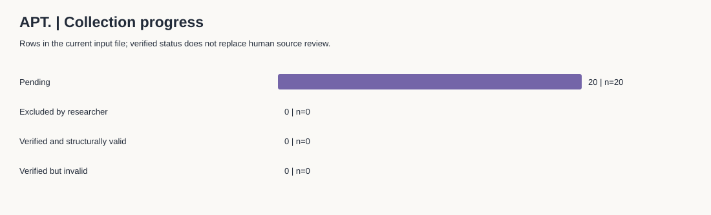

# From Short-form Discovery to Playlist Intent
## K-pop 达人传播观察 × 主题歌单推广方案

**Case: ROSÉ & Bruno Mars — APT. | Independent marketing portfolio | 中文 / English**

> 状态：研究框架与分析工具已完成，20 条公开视频尚待人工采集。当前没有传播效果结论，也没有执行投放。
> 本项目不代表艺人、唱片公司或平台；策略与目标均为独立提案。

### 商业问题
如何用短视频内容和达人选择，让对《APT.》有兴趣的听众愿意进一步探索一份主题歌单？
本项目用小样本公开观察形成创意测试假设，再设计可追踪的歌单推广试验。

### English brief
An independent portfolio exploring how creator-led short-form content could support playlist discovery around ROSÉ & Bruno Mars' “APT.” The project includes a 20-video observation protocol, auditable data templates, reproducible descriptive analysis, and a proposed creator campaign. Data collection and campaign execution are pending; no performance uplift or causal impact is claimed.

### 30 秒浏览
| 想了解什么 | 入口 | 展示的能力 |
|---|---|---|
| 为什么选歌、如何取样 | [研究方法](docs/methodology.md) | Research design / audience insight |
| 数据如何记录与校验 | [CSV 模板](data/raw/videos.csv) · [Excel 模板](data/templates/collection_template.xlsx) · [字段字典](docs/data_dictionary.md) | Data literacy / measurement |
| 现在能得出什么 | [自动报告](reports/analysis_summary.md) · [案例报告模板](reports/case_study.md) | Evidence-based storytelling |
| 如何落成推广方案 | [推广提案](strategy/campaign_plan.md) | Influencer strategy / creative briefs / KPIs |
| 如何上传与展示 | [GitHub 发布指南](docs/github_publish.md) · [求职表达](docs/portfolio_story.md) | Clear communication |



### 现在开始
1. 阅读研究方法，固定搜索条件；先完成 3 条真实记录，检查字段是否好填。
2. 选一个录入入口：直接编辑 `data/raw/videos.csv`；或填写 Excel 的 `Videos` 工作表，再把该工作表单独另存为 **CSV UTF-8**，替换前述 CSV。二者不会自动同步，CSV 是分析的唯一输入。
3. 视频 URL、采集时间和人工确认齐备后，才将该行 `status` 改为 `verified`。看不到的数值留空，原因写入 `missing_metrics_reason`。
4. 在项目文件夹打开终端，运行：

```sh
python scripts/analyze.py
python -m unittest discover -s tests -v
```

Windows 如使用 Python Launcher，可把 `python` 换成 `py`。需要 Python 3.10 或更新版本，无需安装第三方分析库。

5. 查看自动报告、质量问题清单及图表；填写案例报告的证据与结论，然后按指南发布。

### 项目结构
```text
data/
  raw/                 # 20 行模板与搜索日志；真实观察的唯一输入
  templates/           # Excel 录入模板
  processed/           # 脚本生成的逐条指标、分组统计与质量问题
  private_evidence/    # 不公开的核验材料
docs/                  # 方法、字段、来源、发布与求职表达
scripts/analyze.py     # 校验、描述统计与 SVG 图表；无外部依赖
tests/                 # 用明确标记的合成输入检验分析逻辑
reports/               # 自动报告、图表、待填写的商业结论
strategy/              # 推广提案、歌单、达人候选表与 KPI 追踪表
```

### 分析边界
默认只采集 YouTube Shorts 的 20 个不同创作者；分组仅在同一平台内进行。CSV 支持其他平台，但不把不同平台的播放数或比率混成一个排名。公开数据无法证明转化、增量或合作回报。20 条便利样本不代表整个市场。

`verified` 表示研究者已经人工核验，脚本只检查格式与一致性，不会联网验证视频内容。
尚未采集时，图表明确显示无数据；测试中的合成数值不写入真实数据文件。

### 数据与来源
歌曲目录和官方 MV 入口已核对；来源检索日为 **2026-11-07（Australia/Sydney）**。这不是短视频互动数据的采集日。
详见 [来源登记](docs/sources.md) 与 [使用说明](NOTICE.md)。
